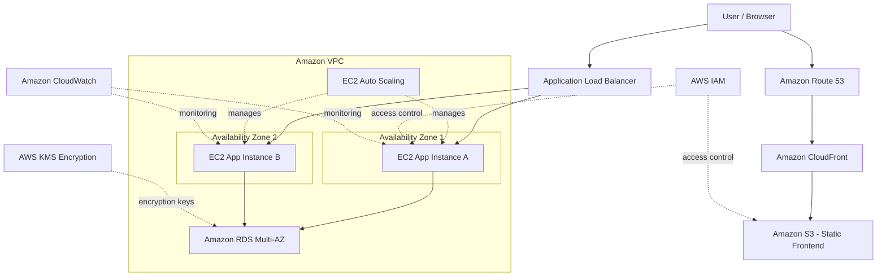

# TaskFlow Cloud — AWS Architecture

## Architecture Diagram

## Component Responsibilities

| AWS Service | Purpose |
|---|---|
| Route 53 | Routes domain requests |
| CloudFront | Delivers frontend content |
| S3 | Stores static frontend files |
| Application Load Balancer | Distributes application requests |
| EC2 Auto Scaling | Maintains the desired number of instances |
| Amazon VPC | Isolates the cloud network |
| RDS Multi-AZ | Provides relational database availability |
| IAM | Controls permissions |
| KMS | Manages encryption keys |
| CloudWatch | Collects metrics, logs, and alarms |

## Security and Availability

- Use public subnets only for resources that require public access.
- Keep application instances and the database in appropriately restricted subnets.
- Use HTTPS/TLS for data in transit.
- Use IAM least-privilege policies.
- Enable supported encryption at rest.
- Deploy application instances across two Availability Zones.
- Test failover, access controls, and recovery before claiming production readiness.

## Implementation Status

This is a proposed reference architecture for the TaskFlow Cloud capstone. The frontend demonstration runs on CodePen. The AWS infrastructure shown above has not been deployed or tested.
